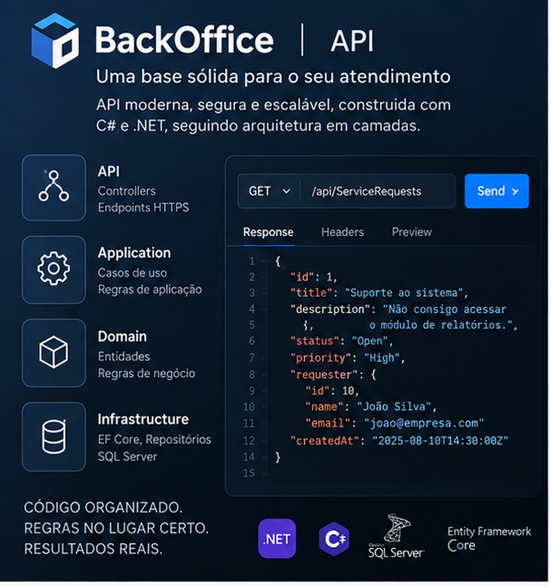
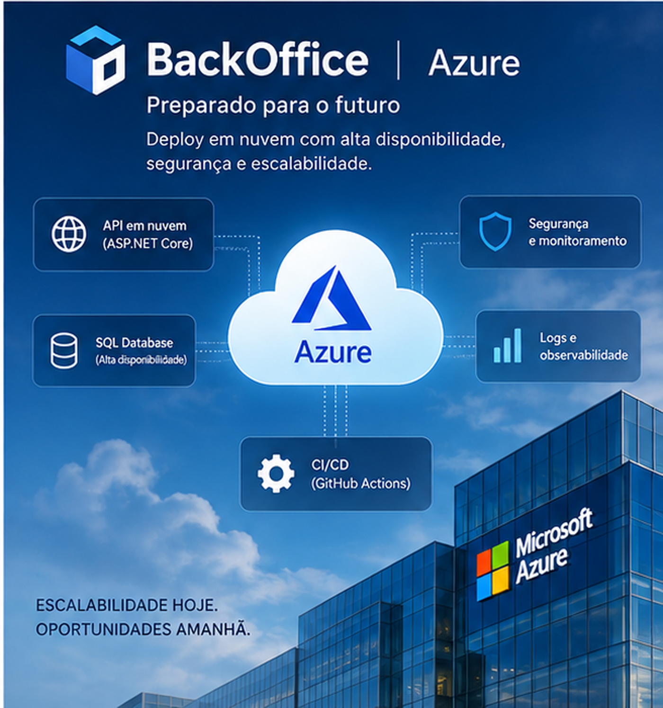

# BackOffice

Sistema de back-office para gerenciamento de solicitações, usuários e fluxos de atendimento, desenvolvido em C#/.NET com
arquitetura em camadas, persistência em SQL Server e testes automatizados.

O backend atual possui autenticação JWT, autorização por perfil e operações de criação, listagem e consulta de solicitações
por ID. A evolução planejada inclui portal web, aplicações mobile, infraestrutura em nuvem e pipelines de integração e entrega.

**Marco validado em 24/10/2026:** 73 casos de teste aprovados.

---

## Visão do produto

O **BackOffice** tem como objetivo centralizar o gerenciamento de solicitações e o fluxo de atendimento entre usuários,
atendentes e administradores.

A solução está sendo construída de forma modular para permitir sua evolução em diferentes interfaces sem acoplar as
regras de negócio à API, banco de dados ou aplicações clientes.

Visão final da plataforma:

```text
                         ┌─────────────────────┐
                         │      Usuários       │
                         └──────────┬──────────┘
                                    │
               ┌────────────────────┼────────────────────┐
               │                    │                    │
               ▼                    ▼                    ▼
        ┌─────────────┐      ┌─────────────┐      ┌─────────────┐
        │ Portal Web  │      │ App Mobile  │      │ App Mobile  │
        │ BackOffice  │      │ Atendente   │      │  Cliente    │
        └──────┬──────┘      └──────┬──────┘      └──────┬──────┘
               │                    │                    │
               └────────────────────┼────────────────────┘
                                    │
                                    ▼
                         ┌─────────────────────┐
                         │ ASP.NET Core Web API│
                         └──────────┬──────────┘
                                    │
                         ┌──────────▼──────────┐
                         │    Application      │
                         │     Use Cases       │
                         └──────────┬──────────┘
                                    │
                         ┌──────────▼──────────┐
                         │       Domain        │
                         │  Regras de negócio  │
                         └──────────┬──────────┘
                                    │
                         ┌──────────▼──────────┐
                         │   Infrastructure    │
                         │ EF Core / Serviços  │
                         └──────────┬──────────┘
                                    │
                                    ▼
                         ┌─────────────────────┐
                         │     SQL Server      │
                         └─────────────────────┘
```

---

## Status do projeto

| Área | Status |
| --- | --- |
| Estrutura da solução e arquitetura em camadas | ✅ Implementadas |
| Domain, Application e Infrastructure | ✅ Base implementada |
| ASP.NET Core Web API | ✅ Implementada |
| SQL Server, EF Core e migrations | ✅ Implementados |
| Repository Pattern e Dependency Injection | ✅ Implementados |
| Testes de domínio, aplicação, infraestrutura e integração | ✅ 73 casos aprovados |
| Entidade de usuário e perfis | ✅ Implementados no domínio |
| Hash de senha com PBKDF2 | ✅ Implementado |
| Login na Application e endpoint HTTP | ✅ Implementados |
| Geração e validação de JWT | ✅ Implementadas |
| Permissões de criação e leitura de solicitações | ✅ Implementadas |
| Consulta de detalhes por ID | ✅ Implementada |
| Rotas centralizadas e arquivo HTTP com token | ✅ Implementados |
| Expansão do atendimento e tratamento global de erros | 🗺️ Planejados |
| Portal Web | 🗺️ Planejado |
| Aplicativo .NET MAUI do atendente | 🗺️ Planejado |
| Aplicativo .NET MAUI do cliente | 🗺️ Planejado |
| Azure e CI/CD | 🗺️ Planejados |

---

## Funcionalidades atuais



### Solicitações

A estrutura atual permite trabalhar com solicitações através das diferentes camadas do sistema.

Fluxo atual:

```text
HTTP Request
    ↓
Controller
    ↓
DTO
    ↓
Use Case
    ↓
Domain
    ↓
Repository
    ↓
Entity Framework Core
    ↓
SQL Server
```

A API possui operações protegidas por token Bearer para criação, listagem e consulta individual:

| Método | Rota | Operação |
| --- | --- | --- |
| POST | `/api/ServiceRequests` | Criar uma solicitação |
| GET | `/api/ServiceRequests` | Listar as solicitações permitidas ao usuário |
| GET | `/api/ServiceRequests/{id}` | Consultar os detalhes de uma solicitação |

As permissões são aplicadas na Application usando o ID e o perfil obtidos do token validado pela API:

| Perfil | Criação | Listagem e detalhes |
| --- | --- | --- |
| `Admin` | Pode indicar um usuário existente como autor | Todas as solicitações |
| `Attendant` | Pode indicar um usuário existente como autor | Todas as solicitações |
| `Requester` | Somente em seu próprio nome | Somente suas próprias solicitações |

A criação recebe `title` e `createdByUserId`. Para `Requester`, o ID informado precisa corresponder ao usuário autenticado.

A consulta por ID retorna `200 OK` quando encontra uma solicitação permitida, `404 Not Found` quando o ID não existe
e `403 Forbidden` quando um solicitante tenta consultar uma solicitação de outra pessoa.

As rotas C# são centralizadas em `ApiRoutes`. O arquivo `BackOffice.Api.http` utiliza as variáveis de
`http-client.env.json` e reaproveita o token do login e o ID devolvido pela criação.

No ambiente local, execute os pedidos HTTP nesta ordem: login, criação e consultas. O arquivo também contém
cenários de consulta sem token e consulta de ID inexistente.

---

### Usuários

O domínio possui uma entidade de usuário com informações como:

```text
Id
Name
Email
Role
PasswordHash
```

Perfis disponíveis:

```text
Admin
Attendant
Requester
```

As regras relacionadas aos usuários permanecem no domínio, sem dependência direta da API ou do banco de dados.

---

### Autenticação

O login HTTP e a geração de tokens JWT estão implementados.

```text
POST /api/Auth/login
    ↓
AuthController recebe LoginInput
    ↓
LoginUseCase procura o usuário por e-mail
    ↓
IPasswordHasher.Verify() confere a senha
    ↓
LoginResult identifica o usuário e o perfil
    ↓
ITokenGenerator / JwtTokenGenerator gera o JWT
    ↓
Resposta com accessToken e expiresAt
```

O endpoint recebe `email` e `password`. Quando as credenciais são válidas, retorna `200 OK` com os dados
de identificação, o perfil, o token e sua expiração. O hash de senha não é incluído na resposta.

Campos obrigatórios ausentes ou vazios recebem `400 Bad Request`. E-mail ou senha incorretos recebem
`401 Unauthorized` com a mensagem genérica `E-mail ou senha inválidos.`.

Para acessar as operações de solicitações, o cliente envia:

```http
Authorization: Bearer <accessToken>
```

---

## Segurança

O serviço `PasswordHasher` armazena a representação derivada da senha e verifica a senha informada no login.

Parâmetros atuais:

```text
PBKDF2 com SHA-256
100000 iterações
salt aleatório de 16 bytes
hash derivado de 32 bytes
comparação com CryptographicOperations.FixedTimeEquals
```

O JWT é assinado com HMAC-SHA256. A API valida a assinatura, o emissor, o destinatário e o prazo de validade
antes de disponibilizar os dados do usuário autenticado aos controllers.

A configuração utiliza `JwtOptions`, com validação na inicialização. A chave de assinatura do ambiente local
fica nos User Secrets da API. `Issuer`, `Audience` e `ExpirationMinutes` ficam na configuração da aplicação.

Os endpoints de solicitações exigem autenticação. As decisões sobre autoria e visibilidade ficam nos casos de uso
da Application, usando a identidade e o perfil extraídos do token validado.

A referência a `System.Security.Cryptography.Pkcs` foi atualizada para `9.0.21` na Infrastructure.

---

## Arquitetura

O BackOffice utiliza uma arquitetura em camadas, separando regras de negócio, casos de uso, infraestrutura e comunicação
HTTP.

Dependências entre os projetos de produção:

```text
BackOffice.Api            → BackOffice.Application
BackOffice.Api            → BackOffice.Infrastructure
BackOffice.Application    → BackOffice.Domain
BackOffice.Infrastructure → BackOffice.Application + BackOffice.Domain
BackOffice.Domain         → sem referências a outros projetos
```

A Application utiliza interfaces. A Infrastructure implementa os repositórios e os serviços técnicos,
e a API configura essas implementações na injeção de dependência. Os fluxos ilustrados neste documento
representam a execução das operações; as referências entre projetos seguem a relação acima.

### BackOffice.Domain

Responsável pelo núcleo da aplicação.

Contém:

```text
Entidades
Enums
Regras de negócio
Validações de domínio
```

Não possui dependência de:

```text
ASP.NET Core
Entity Framework Core
SQL Server
Azure
Interface gráfica
```

---

### BackOffice.Application

Responsável pela execução dos casos de uso.

Contém:

```text
Use Cases
DTOs
Interfaces
Contratos de repositório
Contratos de serviços
```

Exemplos:

```text
CreateServiceRequestUseCase
ListServiceRequestsUseCase
GetServiceRequestByIdUseCase
LoginUseCase
IUserRepository
IServiceRequestRepository
IPasswordHasher
ITokenGenerator
```

---

### BackOffice.Infrastructure

Responsável pelas implementações técnicas necessárias para executar os contratos definidos pelas demais camadas.

Contém:

```text
Entity Framework Core
DbContext
SQL Server
Repositories
Migrations
Database Seeder
PasswordHasher
JwtTokenGenerator
JwtOptions
Serviços técnicos
```

---

### BackOffice.Api

Responsável pela exposição HTTP da aplicação.

Contém:

```text
AuthController
ServiceRequestsController
Rotas centralizadas em ApiRoutes
Dependency Injection
Configuração da aplicação
Autenticação e autorização HTTP
Endpoints HTTP
Respostas da API
```

Os controllers permanecem enxutos e delegam a execução das regras para os casos de uso.

---

## Estrutura atual da solução

```text
BackOffice
│
├── src
│   │
│   ├── BackOffice.Api
│   │
│   ├── BackOffice.Application
│   │
│   ├── BackOffice.Domain
│   │
│   └── BackOffice.Infrastructure
│
├── tests
│   │
│   ├── BackOffice.Application.Tests
│   ├── BackOffice.Domain.Tests
│   ├── BackOffice.Infrastructure.Tests
│   └── BackOffice.Integration.Tests
│
├── BackOffice.slnx
├── README.md
└── LICENSE
```

---

## Persistência

A aplicação utiliza **SQL Server** como banco de dados relacional.

O acesso aos dados é realizado através do **Entity Framework Core**.

```text
Application
    ↓
Repository Interface
    ↓
Infrastructure
    ↓
EF Core Repository
    ↓
DbContext
    ↓
SQL Server
```

As alterações de estrutura do banco são controladas através de migrations.

O banco atualmente contém estruturas relacionadas a:

```text
Users
ServiceRequests
__EFMigrationsHistory
```

---

## Testes automatizados

O último marco validado possui **73 casos de teste aprovados**:

| Projeto | Casos | Cobertura principal |
| --- | ---: | --- |
| `BackOffice.Domain.Tests` | 36 | Entidades, validações e regras do atendimento |
| `BackOffice.Application.Tests` | 19 | Login, criação, listagem, consulta por ID e permissões |
| `BackOffice.Infrastructure.Tests` | 9 | Hash e verificação de senhas |
| `BackOffice.Integration.Tests` | 9 | Login HTTP, criação e listagem, autenticação e assinatura do token |
| **Total** | **73** | |

Um método com `[Theory]` pode executar vários casos por meio de `[InlineData]`. O total acima contabiliza
essas execuções, além dos testes com `[Fact]`.

A estratégia de testes é dividida em quatro níveis:

```text
Domain Tests         → regras de negócio isoladas
Application Tests    → casos de uso e permissões com repositórios falsos
Infrastructure Tests → implementação real do serviço de senha
Integration Tests    → HTTP, controllers, DI, Application, Domain e EF Core/SQL Server
```

Os testes de integração utilizam a configuração local e o banco SQL Server.
As novas rotas de detalhes também foram verificadas manualmente pelo arquivo `.http`, incluindo
resposta de sucesso, ID inexistente e ausência de token.

O objetivo é verificar as regras e os contratos entre as camadas e detectar regressões.

---

## Tecnologias

### Backend

```text
C#
.NET 10
ASP.NET Core Web API
JWT Bearer
PBKDF2 / SHA-256
Entity Framework Core
SQL Server
```

### Testes

```text
xUnit
Testes de domínio
Testes de aplicação
Testes de infraestrutura
Testes de integração
```

### Versionamento

```text
Git
GitHub
```

### Planejado

```text
Portal Web
.NET MAUI
Azure
GitHub Actions
CI/CD
```

---

## Roadmap

### V1 — Base do backend

Base da plataforma e regras centrais.

```text
✅ Arquitetura em camadas
✅ Domain
✅ Application
✅ Infrastructure
✅ Web API
✅ SQL Server
✅ Entity Framework Core
✅ Repository Pattern
✅ Dependency Injection
✅ Migrations
✅ Database Seeder
✅ Service Requests
✅ Users
✅ User Roles
✅ PasswordHash
✅ PBKDF2
✅ LoginUseCase
✅ Serviço de senha integrado ao login e ao seeder
✅ Endpoint de autenticação
✅ Geração e validação de JWT
✅ Permissões de criação e leitura por perfil
✅ Proteção dos endpoints de solicitações
✅ Consulta de detalhes por ID
✅ Rotas centralizadas e requisições HTTP com token
✅ 73 casos de teste aprovados
🗺️ Tratamento global de erros
🗺️ Expansão das funcionalidades de atendimento
```

### Fase 1 — Portal Web


Interface administrativa para operação do BackOffice.

Planejado:

```text
Dashboard
Login
Gerenciamento de usuários
Gerenciamento de solicitações
Filtros
Pesquisa
Detalhes de atendimento
Controle por perfil
Indicadores
```

### Fase 2 e Fase 2B — Mobile


Aplicações móveis integradas à mesma API.

#### Fase 2 — Aplicativo do atendente

Planejado:

```text
Autenticação
Fila de solicitações
Detalhes da solicitação
Atualização de atendimento
Notificações
Histórico
```

#### Fase 2B — Aplicativo do cliente

Planejado:

```text
Autenticação
Criação de solicitação
Acompanhamento
Histórico
Notificações
Perfil
```

A tecnologia planejada para os aplicativos é **.NET MAUI**.

---

### Fase 3 — Cloud



Evolução da solução para infraestrutura em nuvem.

Planejado:

```text
Azure
Hospedagem da API
Banco de dados em nuvem
Configuração por ambiente
Gerenciamento seguro de secrets
Logs
Monitoramento
Observabilidade
Backup
```

---

### Fase 4 / contínua — CI/CD

Automação do ciclo de desenvolvimento e publicação.

Fluxo planejado:

```text
Developer
    ↓
Git Commit
    ↓
GitHub
    ↓
GitHub Actions
    ↓
Restore
    ↓
Build
    ↓
Automated Tests
    ↓
Publish
    ↓
Deploy
```

A intenção é fazer com que alterações aprovadas passem automaticamente por build e testes antes de chegarem ao ambiente
publicado.

---

## Evolução da plataforma

A arquitetura permite que diferentes clientes utilizem o mesmo núcleo de negócio:

```text
                    BackOffice API
                         │
          ┌──────────────┼──────────────┐
          │              │              │
          ▼              ▼              ▼
         Web          Mobile         Integrações
          │              │              │
          └──────────────┼──────────────┘
                         │
                         ▼
                  Application
                         │
                         ▼
                     Domain
                         │
                         ▼
                 Infrastructure
                         │
                         ▼
                    SQL Server
```

Dessa forma, regras de negócio não precisam ser reimplementadas quando novas interfaces forem adicionadas.

---

## Princípios do projeto

O desenvolvimento do BackOffice busca manter:

```text
Separação de responsabilidades
Baixo acoplamento
Código testável
Controllers enxutos
Regras de negócio no domínio
Casos de uso na Application
Infraestrutura substituível
Dependency Injection
Persistência desacoplada
Testes automatizados
Versionamento incremental
Segurança desde a arquitetura
```

---

## Versionamento

O projeto utiliza Git com histórico incremental de alterações.

Padrão utilizado para commits:

```text
feat: nova funcionalidade
fix: correção
test: testes
refactor: refatoração
docs: documentação
chore: manutenção do projeto
```

A evolução do repositório acompanhará todas as etapas da plataforma:

```text
Backend
   ↓
Autenticação
   ↓
Web
   ↓
Mobile
   ↓
Cloud
   ↓
CI/CD
```

---

## Licença

Distribuído sob a licença **MIT**.

Consulte o arquivo `LICENSE` para mais informações.